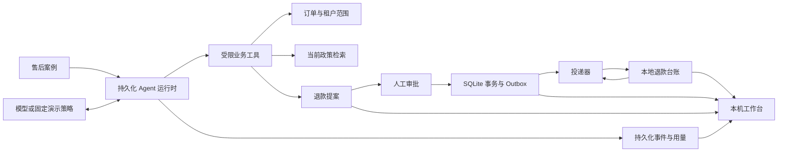
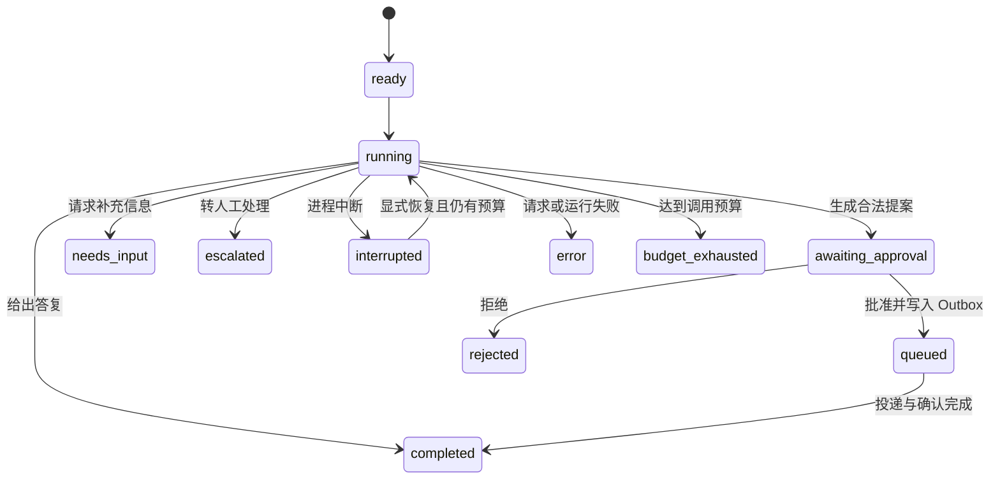

# CaseFlow 设计说明

CaseFlow 处理售后申请：读取所属订单、检索适用政策、提出退款方案，经过人工批准后，将方案交给本地退款模拟器执行。模型负责选择工具与组织回答，退款资格、金额、权限和执行一致性由确定性代码负责。

本项目补充现有作品的能力范围：OpsLens 展示只读调查，PatchForge 展示代码修改与测试反馈，CaseFlow 展示需要批准的业务写入及崩溃后的重放。它是单机工程原型，退款台账是模拟数据，没有连接支付机构，也没有真实转账。

## 组件与信任边界

| 模块 | 职责 | 不应交给模型决定的内容 |
| --- | --- | --- |
| `runtime.py` | 模型请求、工具循环、预算与恢复 | 请求次数、合法状态迁移 |
| `provider.py` | 兼容 Chat Completions 的模型接入 | API Key 处理、错误脱敏 |
| `tools.py` | 订单查询、政策检索、退款提案与结束动作 | 租户、客户范围、工具授权 |
| `store.py` | SQLite 状态、批准事务、Outbox 与退款台账 | 版本校验、唯一约束、退款记账 |
| `fixtures.py` | 可复现的案例、订单与政策 | 样例事实与策略输入的区别 |
| `server.py`、`web/` | 本机任务与审批工作台 | 人工批准入口、任务并发限制 |

检索结果属于业务数据，即使包含“忽略之前指令”等文字，也不能成为授予工具权限的来源。案例绑定的租户与客户来自数据库；工具参数不提供任意选择租户或客户的入口。工作台仅供本机使用，不能将上述范围控制宣传成完整的公网身份认证。

## 模型循环与持久化状态

运行记录保存消息、已经消耗的步骤、用量完整性和状态。请求前先预留步骤并持久化，再调用模型；恢复不能重新获得一份调用预算。请求结果未知时，不能把 token 使用量当成零。

图示强调业务阶段；实际 API 的允许状态以实现与测试为准。`needs_input` 和 `escalated` 是本次处理的终态，不能据此声称已经实现客服接管平台或完整的多轮补充资料会话。

演示模式采用确定性决策，不调用语言模型。它适合复现状态流转、审批和崩溃重放；它的通过率不代表真实模型的理解或规划能力。真实模式采用同一业务工具和校验门槛，但工具选择由模型输出决定。

评测提供两种策略：`direct` 固定预取订单和政策后只允许一次模型决策，`agent` 在原有预算中自主选择查询与后续动作。两种策略使用相同的业务门槛，调用次数与获取上下文的过程不同；结果应比较完整策略的成功与成本，不能解释成完全等预算的模型能力比较。

## 退款提案为何独立于执行

提案包含订单、金额、理由与政策来源。工具层检查订单归属、退款资格、金额和政策版本，并要求引用来源已经由本次运行检索得到。模型无法调用“批准”或“投递”工具。

批准绑定具体提案，而不是一句模糊的“允许退款”。批准事务重新检查当前业务状态与提案快照；旧方案不能因为曾经合法就绕过新的状态变化。若条件变化，调用方应收到明确冲突，并重新调查或提出方案。

批准与投递之间也可能发生变化，因此执行端仍需检查订单及政策版本。已存在相同幂等键的完成结果属于重放路径，应优先返回原始结果；不能因为第一次退款已经改变了订单版本，就让合法的重放永久失败。

来源 ID 存在、版本正确和曾被检索，只能证明引用的来源与流程符合要求，不能证明模型理由在语义上完全正确。业务金额与资格需要独立规则；回答的解释质量仍需要评测或人工复核。

## Outbox 与幂等执行解决什么

批准操作需要同时表达“这个方案已经获得批准”与“有一笔执行任务需要投递”。二者在同一个 SQLite 事务中写入，避免批准成功后任务丢失。

投递器按照持久化的任务调用本地退款模拟器。模拟器以唯一幂等键写入退款台账；投递器随后确认 Outbox。台账写入与 Outbox 确认是两个事务，故意保留了可注入崩溃的窗口。

| 崩溃位置 | 持久化状态 | 恢复后预期行为 |
| --- | --- | --- |
| 批准事务提交前 | 批准和投递任务都未成立 | 调用方重新读取状态后决定是否重试 |
| 批准事务提交后、投递前 | 有待处理任务，无退款记录 | 投递该任务 |
| 台账写入后、Outbox 确认前 | 已有退款记录，任务仍待确认 | 重投相同幂等键，复用已有结果，再确认 |
| Outbox 确认后 | 任务已完成，退款已记录 | 无需再次执行 |

因此，投递语义是**允许重复投递，业务效果通过幂等约束去重**。这里的“一次效果”只覆盖本地模拟台账。真实支付网关还需要对方支持幂等键、查询支付状态、稳定返回原结果，并处理回调、对账与长时间未知状态；一个本地 SQLite 项目无法证明外部支付的端到端 exactly-once。

另一个独立问题是“同一订单的两个不同提案”。相同幂等键去重只处理同一任务的重投，不能替代订单级的剩余可退金额检查和并发状态约束。评测必须分别验证这两类冲突。

## 并发与服务边界

SQLite 保存状态和事件，运行记录使用版本比较更新以防止旧状态覆盖新状态。本地 HTTP 服务限制 worker 数量与活动任务数。Host、Origin、JSON 类型及正文长度检查缩小本机服务的误用面，但不提供生产级账户体系、分布式租约或多节点调度。

一个数据库由一个活动服务进程使用。重启将中断的运行标记出来，避免悄悄重复发起结果未知的收费请求。横向扩展需要另行设计任务领取租约、超时回收和 worker fencing，不能仅增加线程或启动第二个进程。

## 取舍与验收方式

| 选择 | 原因 | 代价与扩展方向 |
| --- | --- | --- |
| 显式工具循环 | 便于查看审批、预算和持久化的实际控制点 | 后续复杂编排可比较成熟框架的维护收益 |
| 确定性业务校验 | 审批与退款规则不能只依赖模型遵守提示 | 需要维护规则版本与迁移方式 |
| 本地 SQLite | 易运行，可演示事务、唯一约束与恢复 | 不等于生产高并发数据库方案 |
| 本地退款模拟器 | 可以稳定复现副作用成功后进程崩溃 | 不覆盖真实网关、网络分区和对账 |
| 明确标注固定演示 | 无 Key 也可验证工程闭环 | 必须另做真实模型评测 |

最有价值的检查是围绕不变量构造反例：越权订单不可读、外租户与旧政策不可作为有效依据、未检索来源不可用于提案、旧版本方案不可批准、重复批准与重投不可重复退款、恢复不能重置预算。测试通过说明这些已覆盖条件符合预期；不应扩写成系统没有漏洞或模型不会受提示注入影响。

实际运行命令、已完成的验证与仍未实测的能力，以项目 [README](../README.md) 和保留的运行产物为准。
